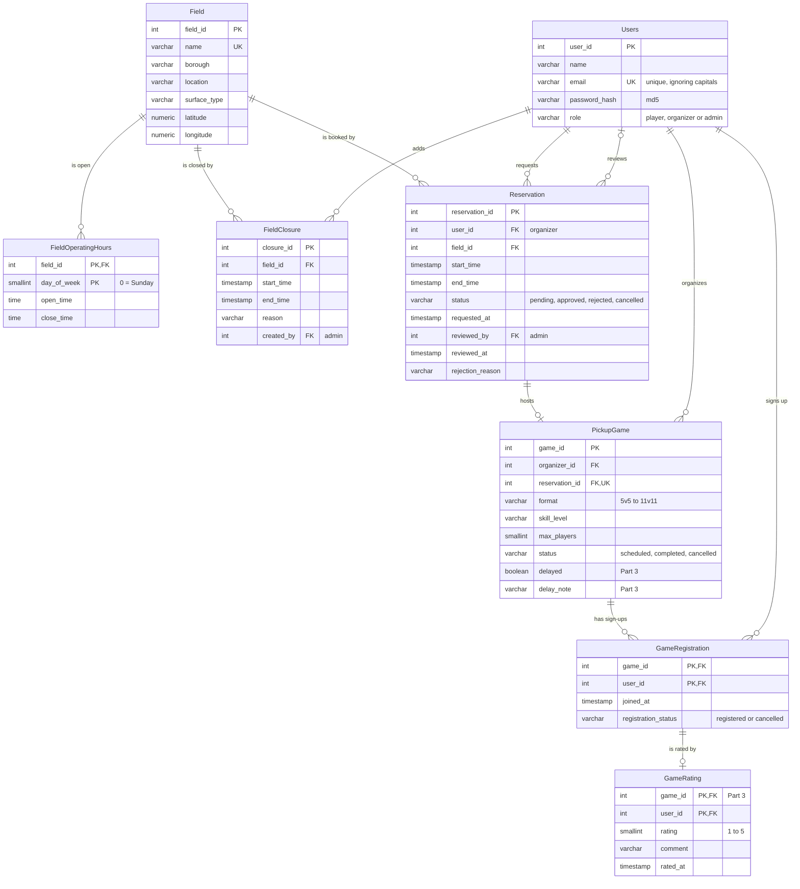

# Database schema (Part 3)

The tables from Part 2, plus what Part 3 added: the `GameRating` table and `PickupGame.delayed` / `delay_note`. The full definitions, with every constraint, are in [`db/schema.sql`](../db/schema.sql); the same tables are merged back into `part2/create_tables.sql`. GitHub draws the diagram below; for an image file, paste the `mermaid` block into https://mermaid.live and export a PNG.

Not shown: the `GameState` view (each game's state, worked out from `PickupGame` and `Reservation`), and the `session` table that stores logins.

## Relational schema

Primary keys are **bold**; foreign keys are marked → with the table they point to.

- **Users**(**user_id**, name, email, password_hash, role)
- **Field**(**field_id**, name, borough, location, surface_type, latitude, longitude)
- **FieldOperatingHours**(**field_id** → Field, **day_of_week**, open_time, close_time)
- **FieldClosure**(**closure_id**, field_id → Field, start_time, end_time, reason, created_by → Users)
- **Reservation**(**reservation_id**, user_id → Users, field_id → Field, start_time, end_time, status, requested_at, reviewed_by → Users, reviewed_at, rejection_reason)
- **PickupGame**(**game_id**, organizer_id → Users, reservation_id → Reservation (unique), format, skill_level, max_players, status, delayed, delay_note)
- **GameRegistration**(**game_id** → PickupGame, **user_id** → Users, joined_at, registration_status)
- **GameRating**(**game_id**, **user_id**, rating, comment, rated_at), with (game_id, user_id) → GameRegistration

Rules worth knowing:
- Approved bookings of one field can't overlap: an exclusion constraint on `Reservation`.
- A rating needs the player's sign-up (composite foreign key). A trigger also requires that the game was played: booking approved, sign-up not cancelled, game over.
- A delay note exists only while the game is delayed (`chk_game_delay_note`).
- Emails are unique, ignoring capitals.

## Diagram

